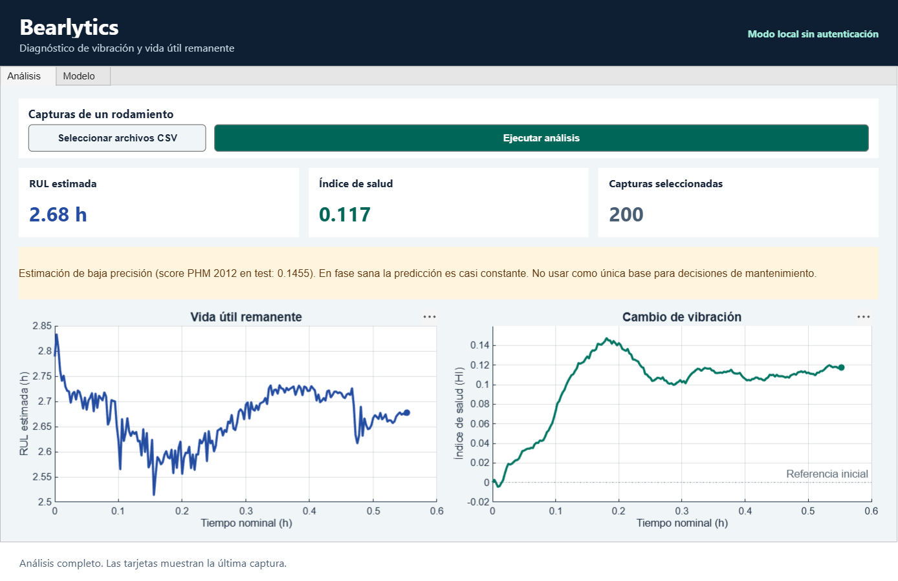
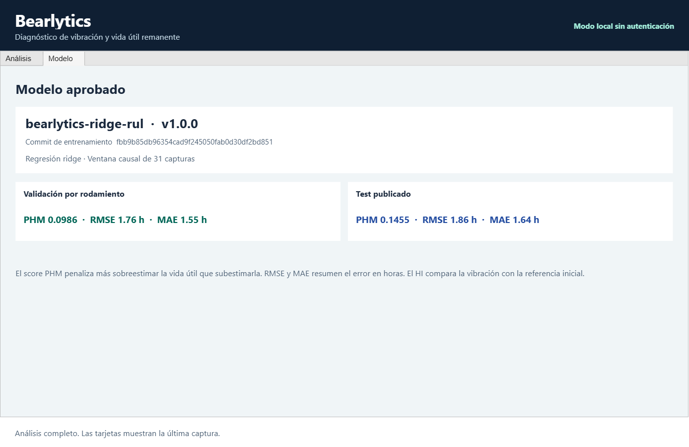

# Aplicación MATLAB de Bearlytics

La app analiza las capturas de un solo rodamiento y presenta la RUL estimada, su trayectoria y el cambio de vibración respecto al arranque. La pestaña **Modelo** muestra la versión, el commit de entrenamiento y las métricas del artefacto ridge.

## Ejecutar en local

Desde la raíz del repositorio en MATLAB R2026b:

```matlab
addpath(pwd, fullfile(pwd, 'App'));
BearlyticsApp
```

Para inspeccionar el archivo en App Designer, ejecuta `appdesigner(fullfile(pwd,'App','BearlyticsApp.mlapp'))`. La interfaz crea sus controles desde el código de la app. La lógica reutilizable está en `+bearlytics/+app/`.

1. Pulsa **Seleccionar archivos CSV** y elige las capturas de una sola carpeta, desde `acc_00001.csv` y sin huecos. Puedes seleccionar hasta 3.000 archivos. La app los ordena por el número de captura.
2. Pulsa **Ejecutar análisis**. La barra muestra el avance y permite cancelar.
3. Lee la RUL y el HI de la última captura en las tarjetas. Las dos gráficas muestran la serie completa. La línea de HI = 0 corresponde a la referencia inicial. La RUL es una estimación de baja precisión y requiere criterio de mantenimiento.





## Pruebas

Para reproducir la aceptación, ajusta la variable a tu carpeta extraída de FEMTO y ejecuta las suites desde la raíz. La prueba compara las primeras 200 capturas de `Bearing1_3` con las predicciones publicadas.

```matlab
addpath(pwd);
setenv('BEARLYTICS_TEST_BEARING_DIR', fullfile(pwd, '10. FEMTO Bearing', ...
    'Full_Test_Set', 'Bearing1_3'));
import matlab.unittest.TestSuite
files = {'App/test_app_logic.m', '+bearlytics/+security/test_security.m', ...
    'Security/pruebas_seguridad_integracion.m', ...
    'PreProcess/test_preprocess.m', 'Modeling/test_modeling.m'};
suite = TestSuite.fromFile(files{1});
for k = 2:numel(files)
    suite = [suite, TestSuite.fromFile(files{k})];
end
results = run(suite);
assertSuccess(results);
```

Pasaron 67 pruebas. En la referencia de 200 capturas, la diferencia máxima de RUL fue de `3.82e-11 s`. La última fila mostró 2,68 h y un HI de 0,117. [Salida de MATLAB](../results/app_matlab_batch.txt) · [Resultado por prueba](../results/app_test_results.csv)

## Despliegue

La aplicación entregada corresponde al plan local. Usa un principal fijo de demostración y el JSON publicado, cuya cabecera se compara con la lista aprobada. La versión local bloquea el flujo de inferencia si se inicia como aplicación compilada. Este entorno cuenta con licencia de Compiler, pero la instalación no incluye el empaquetador Web App Compiler. Keycloak, TLS, Vault Transit y la firma del artefacto quedan pendientes de integración y prueba en servidor. [Guía de integración en servidor](../Security/MATLAB_WEB_APP_HANDOFF.md)

Si falta Statistics and Machine Learning Toolbox, `computeTimeFeatures` usa los momentos centrales normalizados equivalentes a `kurtosis(x,1)` y `skewness(x,1)`. La comparación FEMTO anterior se ejecutó con esa alternativa.
