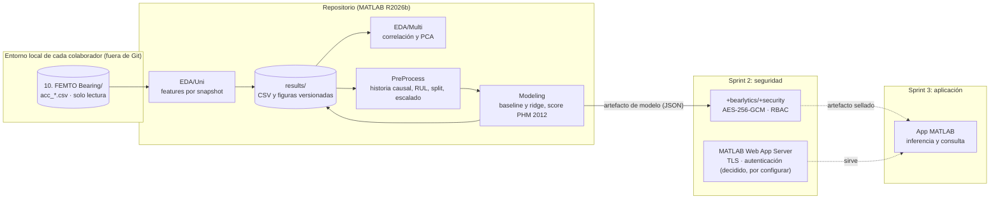

# Bearlytics — Planteamiento y arquitectura

Documento del **sprint 1**. Recoge el problema, el alcance, la arquitectura de la plataforma y los **contratos entre sprints**. Describe lo que existe en el repositorio y marca con claridad lo que es **propuesta** para sprints posteriores. Los controles de seguridad no se definen aquí, sino en `Security/README.md` (sprint 2); este documento solo indica dónde encajan.

> Última revisión: 2026-11-24. Cuando un PR cambie un componente o un contrato descrito aquí, debe actualizar este documento.

## 1. Planteamiento

### 1.1 Problema

Un rodamiento que falla sin aviso detiene la máquina que lo contiene y puede dañar otros componentes. El mantenimiento preventivo por calendario sustituye piezas que aún sirven; el correctivo llega tarde. Bearlytics estima la **vida útil remanente (RUL, *Remaining Useful Life*)** de un rodamiento a partir de sus señales de vibración, para planificar la intervención antes del fallo.

### 1.2 Por qué es un problema de ciberseguridad

En un entorno industrial, la predicción de RUL alimenta decisiones operativas: cuándo parar, qué sustituir, qué riesgo se acepta. Por eso la **integridad y la autenticidad** del modelo y de sus datos importan tanto como su precisión:

- Un modelo alterado que **sobreestima** la RUL retrasa el mantenimiento hasta el fallo. La métrica del proyecto (score PHM 2012) ya castiga más la sobreestimación por esa razón.
- Un modelo alterado que **subestima** la RUL provoca paradas y sustituciones innecesarias: un ataque de coste o de disponibilidad.
- Las predicciones y los datos de operación revelan el estado de los activos de una planta: requieren **confidencialidad** y control de acceso.

El modelado de amenazas (STRIDE + CIA+) y los controles los define el sprint 2.

### 1.3 Objetivos

1. Construir un pipeline reproducible (EDA → preprocesamiento → modelado) que estime la RUL y se evalúe con el score PHM 2012 (Nectoux et al., 2012).
2. Proteger el ciclo de vida del modelo: integridad de artefactos, control de acceso por rol y trazabilidad (sprint 2).
3. Exponer la inferencia a usuarios mediante una aplicación MATLAB con evidencias de prueba (sprint 3).
4. Documentar resultados y limitaciones sin inventar cifras (sprint 4).

### 1.4 Alcance

| Dentro | Fuera |
|---|---|
| Dataset FEMTO/PRONOSTIA (IEEE PHM 2012), 17 rodamientos completos | Datos de planta reales o en streaming |
| Features de vibración en dominio temporal, H y V | Temperatura (`temp_*.csv`), no usada para RUL |
| Modelos de RUL evaluados con protocolo leave-one-bearing-out | Despliegue productivo a escala; el despliegue previsto es MATLAB Web App Server (§3.5) |
| Controles de seguridad sobre código, artefactos y una futura capa de entrada | Certificación de seguridad o cumplimiento normativo |

## 2. Organización y metodología

Trabajo ágil en 4 sprints, uno por integrante:

| Sprint | Entregables | Estado (2026-11-24) |
|---|---|---|
| 1 | Planteamiento y arquitectura · Dataset y preprocesamiento · Modelo + evaluación IA | EDA/Uni, EDA/Multi y PreProcess en `main`; Modeling en revisión (#11); este documento |
| 2 | Criptografía · Autenticación/RBAC · Seguridad del gateway · STRIDE + CIA+ | En revisión (#9 documento, #10 cifrado y RBAC) |
| 3 | Pruebas y evidencias · App MATLAB (scripts) | Pendiente |
| 4 | Reporte y presentación | Pendiente |

Reglas de colaboración (detalle en `AGENTS.md` §7 y `Agentes/GIT_WORKFLOW.md`): `main` protegida, ramas cortas por entregable, PR con 1 aprobación de otra persona y CI en verde, merge por squash o rebase, y un **gate** por fase del pipeline. La comunicación entre sprints se hace en los comentarios de los PR.

## 3. Arquitectura

### 3.1 Vista general

Las líneas continuas existen hoy. Las discontinuas son la integración propuesta entre sprints (§5).

### 3.2 Componentes del pipeline (existentes)

| Componente | Entrada | Salida | Punto de entrada | Detalle |
|---|---|---|---|---|
| **Acceso a datos** (`+bearlytics/`) | `acc_*.csv` (2.560 filas × 6 columnas; señales en columnas 5 y 6) | Señales H/V por snapshot | `loadAccSnapshot`, `computeTimeFeatures` | `README.md` (guía del dataset) |
| **EDA/Uni** | Dataset local, `Learning_set` + `Full_Test_Set` | `results/eda_uni_features.csv` (24.889 snapshots × 8 features) y figuras | `EDA/Uni/run_eda_uni.m` | `EDA/Uni/README.md` |
| **EDA/Multi** | `results/eda_uni_features.csv` | Spearman por rodamiento, PCA, `results/eda_multi/` | `EDA/Multi/run_eda_multi.m` | `EDA/Multi/README.md` |
| **PreProcess** | `results/eda_uni_features.csv` | Un fold por rodamiento de validación: `train/validation/test.csv`, `predictors.csv`, `scaler.csv` (no versionados) | `PreProcess/run_preprocess.m` | `PreProcess/README.md` |
| **Modeling** | 6 folds de PreProcess | Métricas, predicciones y figuras en `results/modeling_*` | `Modeling/run_modeling.m` | `Modeling/README.md` |

Decisiones de diseño que afectan a todo el pipeline:

- **Stack único:** solo MATLAB R2026b con Signal Processing y Statistics and Machine Learning Toolbox (`AGENTS.md` §2).
- **Dataset fuera de Git y de solo lectura:** cada colaborador lo descarga; las rutas se resuelven de forma relativa a la raíz del repo.
- **Separación por rodamiento:** ningún rodamiento aparece en más de un split. Validación leave-one-bearing-out sobre los 6 de `Learning_set`; test con los 11 de `Full_Test_Set`, evaluado una sola vez. `Test_set` se excluye porque repite los mismos rodamientos truncados.
- **Sin fuga:** el escalador y los hiperparámetros se ajustan solo con train/validación; las features de historia son causales (solo usan snapshots anteriores).
- **Reproducibilidad:** cada fase tiene un script de entrada ejecutable con `matlab -batch` y pruebas con `runtests`; las cifras publicadas salen de esas ejecuciones.

### 3.3 Estado del modelo

El mejor modelo actual es una regresión ridge sobre 32 predictores. En test obtiene un score PHM 2012 de 0,1455 frente a 0,1340 de un baseline constante, con RMSE algo peor (resultados y limitaciones en `Modeling/README.md`, PR #11). Es un modelo **débil**: mientras el rodamiento está sano, su predicción es casi constante. Esto condiciona la aplicación del sprint 3, que debe mostrar la predicción con su incertidumbre y no como un dato exacto.

### 3.4 Límites de confianza

| Zona | Qué contiene | Quién escribe | Control actual |
|---|---|---|---|
| Dataset local | Señales FEMTO | Nadie (solo lectura) | Fuera de Git, `.gitignore` |
| Repositorio | Código, configuración, resultados versionados | Colaboradores vía PR | Ruleset de `main`, CODEOWNERS, CI, revisión humana |
| Artefactos derivados no versionados | Folds (`results/preprocess/`), `.mat` | El pipeline local | `.gitignore`; regenerables |
| Artefacto de modelo | Coeficientes, escalador y metadatos (`results/modeling_ridge_rul_model.json`) | Modeling | Validación al decodificar; sellado AES-256-GCM al distribuirlo (sprint 2) |
| Aplicación servida por MATLAB Web App Server (futura) | Peticiones de usuarios | Usuarios autenticados por el servidor | Autenticación en el servidor + `isActionAllowed` en la app (sprint 2) |

### 3.5 Despliegue (decidido 2026-11-25)

El equipo acordó servir la app del sprint 3 con **MATLAB Web App Server**. Consecuencias para la arquitectura:

- **Empaquetado:** la app MATLAB se compila como web app (MATLAB Compiler) y se publica en el servidor. Requiere licencias de MATLAB Compiler y de Web App Server.
- **Punto de entrada:** el servidor hace el papel de gateway. TLS, autenticación de usuarios y límites de acceso se configuran en el servidor (o en un proxy inverso delante de él), no en el código de la app. La configuración concreta, el proveedor de identidad y el almacén de claves los define el sprint 2 a partir de la documentación de MathWorks para R2026b.
- **Autorización:** la app recibe una identidad ya autenticada por el servidor y aplica `bearlytics.security.isActionAllowed(role, action)` antes de cada acción.
- **Artefacto de modelo:** se carga desde almacenamiento del servidor, se abre con `openArtifact` (clave fuera del paquete de la app) y se decodifica con `decodeModelArtifact`.
- **Stack:** se mantiene 100 % MATLAB (`AGENTS.md` §2); no hace falta reimplementar la inferencia en otro lenguaje.

## 4. Requisitos no funcionales

| Atributo | Requisito | Cómo se verifica |
|---|---|---|
| Reproducibilidad | Toda cifra publicada sale de un script de entrada | Evidencia `matlab -batch` en cada PR |
| Corrección metodológica | Sin fuga entre splits; test evaluado una vez | `loadFold` rechaza folds con fuga; pruebas de PreProcess y Modeling |
| Integridad | Ningún cambio llega a `main` sin revisión | Ruleset: PR, 1 aprobación ajena, CI |
| Confidencialidad | Sin secretos ni datos pesados en Git | `.gitignore`; política del sprint 2 |
| Mantenibilidad | Funciones documentadas, una por fichero, identificadores en inglés | Revisión de PR (`AGENTS.md` §5) |

## 5. Contratos entre sprints

Esta sección coordina los sprints. §5.1 está acordada e implementada; el resto es **propuesta** que cada responsable valida o corrige en su PR.

### 5.1 Artefacto de modelo: sprint 1 → sprints 2 y 3 (implementado)

Formato acordado con el sprint 2 en #12 e implementado en `+bearlytics/+model/` y `Modeling/export_ridge_model.m`. El esquema completo está en `Modeling/README.md` (*Artefacto de modelo*). Resumen:

| Campo | Contenido |
|---|---|
| `header` | `schemaVersion`, `modelId`, `modelVersion`, `modelType`: se autentica como AAD |
| `predictorNames` | Lista ordenada de los 32 predictores (`predictors.csv`) |
| `windowSnapshots` | Ventana de historia causal (31) |
| `scaler` | `center` y `scale` ajustados con los 6 rodamientos de `Learning_set` |
| `model` | `intercept`, `coefficients`, `alpha`, `lambda` |
| `training` | Rodamientos de entrenamiento, commit de origen y fecha UTC |
| `metrics` | Score, RMSE y MAE de validación y test, para mostrar en la app |

Flujo: `encodeModelArtifact` devuelve el payload JSON y la cabecera → `bearlytics.security.sealArtifact` cifra el payload con AES-256-GCM, autenticando la cabecera como AAD (adaptación del sprint 2) → se almacena con su SHA-256 → la app lo abre con `openArtifact`, que falla si el contenido o la cabecera fueron alterados, y lo decodifica con `decodeModelArtifact`. La clave la suministra un gestor de secretos, nunca el repositorio (`Security/README.md`). Si el productor y el consumidor del artefacto son independientes, la etiqueta GCM no basta para autenticar al productor y hace falta además una **firma digital** (sprint 2).

### 5.2 Aplicación: sprint 3

- **Entrada:** una secuencia de snapshots de un rodamiento (o la fila de features ya calculada), con la misma ventana causal que en entrenamiento.
- **Proceso:** calcular features con las mismas funciones de `+bearlytics/` → `bearlytics.model.predictRulFromArtifact`, que aplica el escalador del artefacto y predice. **Pendiente:** la historia causal de los predictores la calcula hoy `prepareRulTable`, que exige trayectorias completas; hace falta una función para secuencias en curso (siguiente PR del sprint 1).
- **Autorización:** consultar `bearlytics.security.isActionAllowed(role, action)` solo después de validar la identidad, con las acciones de la matriz del sprint 2 (`predictions:read`, `predictions:run`, `models:publish`). La identidad la aporta una capa de autenticación confiable, no la app.
- **Evidencias:** pruebas de que la app reproduce las predicciones de `results/modeling_ridge_rul_test_predictions.csv` para el mismo artefacto.

### 5.3 Reporte: sprint 4

Todas las cifras del reporte deben citar su fichero en `results/` o el PR donde se publicaron. Las limitaciones del modelo (§3.3) y el estado real del despliegue (§3.5) deben aparecer de forma explícita.

## 6. Riesgos del proyecto

| Riesgo | Impacto | Mitigación |
|---|---|---|
| Modelo con poca capacidad predictiva en fase sana | La app puede dar una falsa sensación de precisión | Mostrar la incertidumbre; siguiente modelo con índice de salud relativo (recomendación de EDA/Multi), seleccionado solo con los 6 folds |
| Test ya consumido | Comparaciones futuras sesgadas si se vuelve a usar para decidir | Seleccionar solo con validación; documentar cualquier reevaluación |
| Features de inferencia solo para trayectorias completas | La app no puede predecir sobre un rodamiento en marcha | Función de historia causal sin RUL, reutilizada por PreProcess (§5.2) |
| Proveedor de identidad y almacén de claves sin decidir | Bloquea la autenticación real en MATLAB Web App Server | Sprint 2: elegirlos y documentar la configuración del servidor |
| Licencias de MATLAB Compiler y Web App Server | Sin ellas no se puede empaquetar ni servir la app | Confirmar disponibilidad antes del sprint 3 |
| Servidor sin desplegar al cierre | Los controles de red quedarían solo en diseño | Declararlo en el reporte; no simular seguridad de red en MATLAB |

## 7. Referencias

- P. Nectoux et al., *PRONOSTIA: An Experimental Platform for Bearings Accelerated Life Test*, IEEE PHM 2012.
- A. E. Hoerl y R. W. Kennard, *Ridge Regression: Biased Estimation for Nonorthogonal Problems*, Technometrics, 1970.
- Documentos internos: `README.md`, `AGENTS.md`, `Agentes/WORKFLOWS.md`, `Agentes/GIT_WORKFLOW.md`, y los README de cada fase y `Security/README.md` (sprint 2, PR #9).
